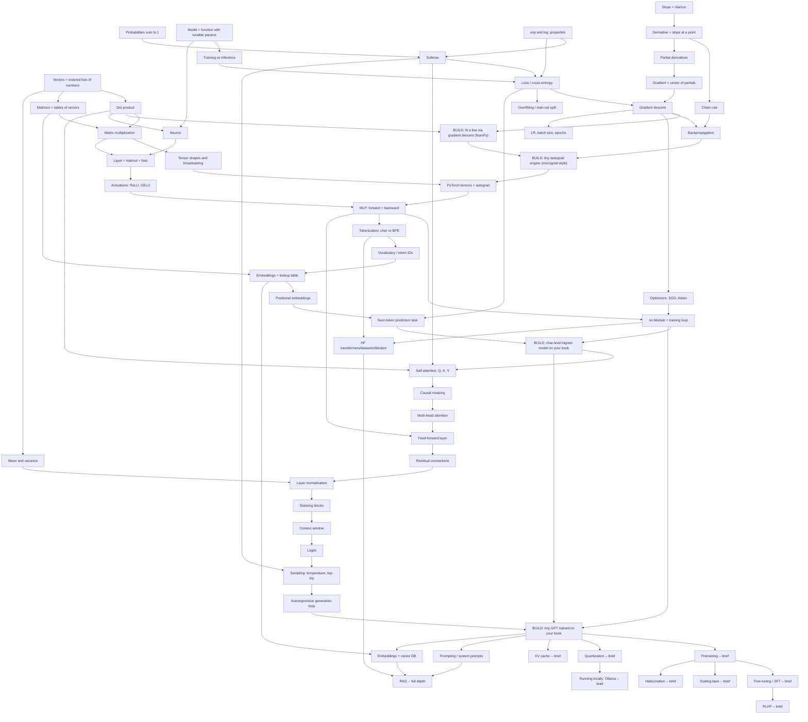

# LLM-from-scratch roadmap

The LearnHarness map for this course, copied as-is from the LLMs session. Goal: build a tiny GPT on a book in PyTorch on a Mac.

This is the map as of 2026-11-17, after adding the extra math nodes, the BUILD checkpoints, and marking post-build topics as brief. If LearnHarness changes it again, the latest version is in the newest export in `notes/`.

## What each node teaches

### Roots
| Node | What it teaches |
|---|---|
| Slope = rise/run | How fast output changes per unit of input |
| Vectors = ordered lists of numbers | Representing a thing (later, a token) as an array of numbers |
| Probabilities sum to 1 | What a probability distribution is |
| Model = function with tunable params | A model is a function whose numbers (parameters) get adjusted |
| exp and log: properties | Exponentials and logarithms; softmax uses exp, cross-entropy uses log |

### Math
| Node | What it teaches |
|---|---|
| Derivative = slope at a point | Slope of a curve at one spot: "nudge the input, how does output move?" |
| Chain rule | Derivative of a function inside a function; backprop is built on it |
| Partial derivatives | Slope for one parameter while holding the others fixed |
| Gradient = vector of partials | All the partial derivatives together: which way to adjust every parameter |
| Dot product | Multiply element-wise and sum; a measure of similarity |
| Matrices = tables of vectors | Many vectors stored together |
| Mean and variance | Average and spread of numbers; layer normalization uses them |
| Matrix multiplication | Many dot products at once; the core operation of every layer |
| Tensor shapes and broadcasting | How (batch, sequence, dimension) arrays combine; where most PyTorch bugs come from |
| Softmax | Turns any list of scores into probabilities |

### Training
| Node | What it teaches |
|---|---|
| Training vs inference | Learning the parameters vs using them |
| Loss / cross-entropy | One number for "how wrong was the prediction" |
| Gradient descent | Step every parameter a little against its gradient, repeat |
| **BUILD: fit a line via gradient descent (NumPy)** | Gradient descent end to end in a few lines of NumPy |
| Backpropagation | Computing all the gradients efficiently, layer by layer |
| **BUILD: tiny autograd engine (micrograd-style)** | Writing the thing that computes gradients automatically |
| Optimizers: SGD, Adam | Smarter ways to take those steps |
| Overfitting / train-val split | Memorizing vs generalizing, and how to detect it |
| LR, batch size, epochs | The main dials of a training run |

### Neural networks and PyTorch
| Node | What it teaches |
|---|---|
| PyTorch tensors + autograd | Arrays on the GPU that compute their own gradients (your micrograd, industrial strength) |
| Neuron | Dot product of inputs and weights, plus bias |
| Layer = matmul + bias | A whole layer of neurons as one matrix multiplication |
| Activations: ReLU, GELU | The nonlinearity that lets networks learn more than straight lines |
| MLP: forward + backward | Stacked layers: data flows forward, gradients flow back |
| nn.Module + training loop | Structuring a model and the code that trains it |

### Text
| Node | What it teaches |
|---|---|
| Tokenization: char vs BPE | Splitting text into characters or sub-word pieces |
| Vocabulary / token IDs | Each token gets an integer ID |
| Embeddings = lookup table | Token ID → vector, like an index lookup |
| Positional embeddings | Telling the model where each token sits |
| Next-token prediction task | The single task a GPT is trained on |
| **BUILD: char-level bigram model on your book** | The simplest language model: guess the next character from the current one |

### Transformer
| Node | What it teaches |
|---|---|
| Self-attention: Q, K, V | Each token does a soft, weighted lookup over the other tokens |
| Causal masking | A token can't see tokens after it |
| Multi-head attention | Several attention lookups in parallel |
| Feed-forward layer | A per-token MLP after attention |
| Residual connections | Adding the input back so deep stacks still train |
| Layer normalization | Keeping numbers in a stable range between layers |
| Stacking blocks | Repeating the transformer block N times |
| Context window | How many tokens the model sees at once |

### Generation
| Node | What it teaches |
|---|---|
| Logits | The raw scores the model outputs for every possible next token |
| Sampling: temperature, top-k/p | Choosing the next token, and controlling randomness |
| Autoregressive generation loop | Generate a token, append it, repeat |

### Goal
| Node | What it teaches |
|---|---|
| **BUILD: tiny GPT trained on your book** | Putting it all together: a small transformer trained on a book, generating text in its style |

### After the build
| Node | What it teaches |
|---|---|
| Pretraining (brief) | Training on huge amounts of text |
| Fine-tuning / SFT (brief) | Further training on examples of the behaviour you want |
| RLHF (brief) | Tuning with human preference feedback |
| Scaling laws (brief) | Why bigger models with more data keep getting better |
| Hallucination (brief) | Why models confidently make things up |
| Quantization (brief) | Shrinking a model by storing its numbers with fewer bits |
| Running locally: Ollama (brief) | Running real models on your own machine |
| KV cache (brief) | Reusing past attention work so generation is fast |
| HF transformers/datasets/tiktoken | Ready-made tokenizers, datasets and pretrained models |
| Prompting / system prompts | Steering a model with instructions |
| Embeddings + vector DB | Storing text as vectors and searching by meaning |
| RAG (full depth) | Retrieving relevant text and giving it to the model to answer from; how you actually ask questions about the book |
