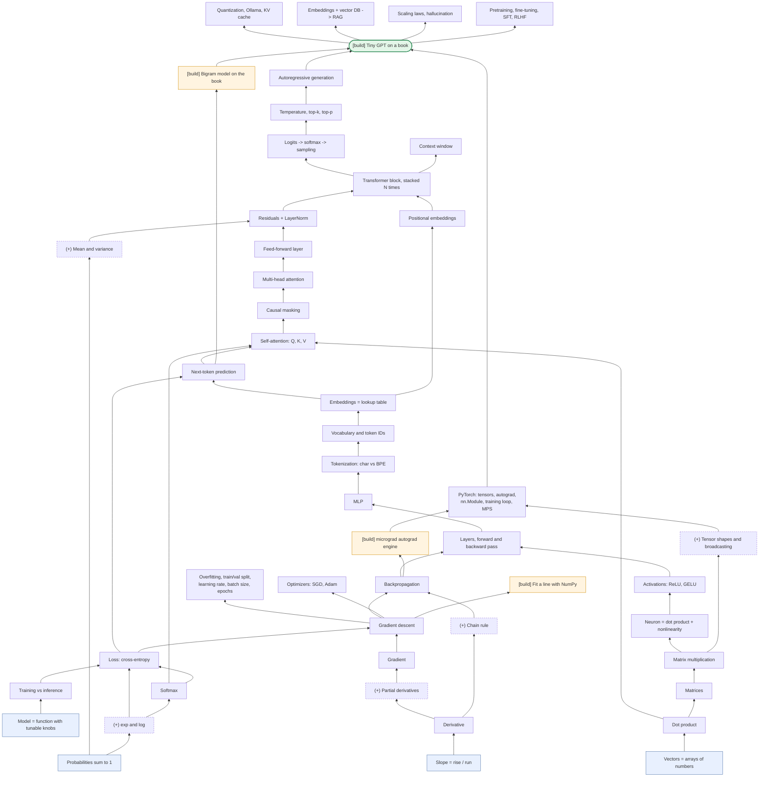

# LLM Learning Roadmap

Goal: understand how LLMs work from the ground up, then **build and train a tiny GPT on a book** in PyTorch on a Mac.

Based on the LearnHarness plan (see `notes/LLMs.md`). Nodes marked **(+)** are additions suggested on top of it; nodes marked **[build]** are hands-on checkpoints.

## Map

## What each part teaches

### Roots
| Node | What it teaches | Why it matters for the GPT |
|---|---|---|
| Slope = rise / run | How fast output changes per unit of input | Training asks "if I nudge this knob, how fast does the error change?" |
| Vectors | A list of numbers that represents something | Every token becomes a vector |
| Probabilities sum to 1 | What a probability distribution is | The model outputs a distribution over the next token |
| Model = function with knobs | Parameters are just numbers you tune | A GPT is a function with millions of knobs |

### Math chains
| Node | What it teaches | Why it matters |
|---|---|---|
| Dot product | Multiply element-wise, then sum; measures similarity | Attention scores are dot products |
| Matrices / matmul | Many dot products at once | Every layer is a matrix multiplication |
| (+) Tensor shapes, broadcasting | How (batch, seq, dim) arrays combine | Where most PyTorch bugs happen |
| Derivative | Slope of a curve at one point | Tells which direction reduces the error |
| (+) Chain rule | Derivative of a function inside a function | Backpropagation *is* the chain rule |
| (+) Partial derivatives | Slope for one knob while holding others fixed | Each parameter gets its own slope |
| Gradient | All the partial derivatives together | The direction to update every knob |
| (+) exp and log | Exponentials and logarithms | Softmax uses exp; cross-entropy uses log |
| Softmax | Turns any numbers into probabilities | Turns model scores into next-token odds |
| (+) Mean and variance | Average and spread of numbers | LayerNorm uses them |

### Machine learning basics
| Node | What it teaches |
|---|---|
| Training vs inference | Learning the knobs vs using them |
| Cross-entropy loss | A single number for "how wrong was the prediction" |
| Gradient descent | Step the knobs a little against the gradient, repeat |
| **[build] Fit a line with NumPy** | ~20 lines: gradient descent end to end |
| SGD, Adam | Smarter ways to take those steps |
| Backpropagation | Computing gradients for every knob efficiently |
| **[build] micrograd** | Write a tiny autograd engine yourself |
| Overfitting, train/val, LR, batch, epochs | The practical dials of training |

### Neural networks
| Node | What it teaches |
|---|---|
| Neuron | Dot product + bias + nonlinearity |
| ReLU, GELU | Why nonlinearity lets networks learn curves |
| Layers, forward/backward | Data flows forward, gradients flow back |
| MLP | Stacked layers; the "feed-forward" part of a transformer |

### Working with text
| Node | What it teaches |
|---|---|
| Tokenization | Splitting text into characters or sub-word pieces (BPE) |
| Vocabulary, token IDs | Each token gets an integer ID |
| Embeddings | A lookup table: ID → vector (like a DB index → row) |
| Positional embeddings | Telling the model *where* each token is |
| Next-token prediction | The one task GPT is trained on |
| **[build] Bigram model** | Predict the next character of your book from the current one |

### The Transformer
| Node | What it teaches |
|---|---|
| Self-attention (Q, K, V) | Each token does a soft, weighted lookup over other tokens |
| Causal masking | A token can't look at future tokens |
| Multi-head attention | Several lookups in parallel, each learning different patterns |
| Feed-forward layer | Per-token MLP after attention |
| Residuals + LayerNorm | What keeps deep stacks trainable |
| Transformer block × N | The repeating unit of a GPT |
| Context window | How many tokens the model can see at once |

### Generation
| Node | What it teaches |
|---|---|
| Logits → softmax → sampling | Picking the next token from the model's output |
| Temperature, top-k, top-p | Controlling how random or focused the output is |
| Autoregressive generation | Generate one token, append it, repeat |

### Tools
| Node | What it teaches |
|---|---|
| Python + NumPy | Arrays and the math by hand |
| PyTorch | Tensors, autograd, `nn.Module`, training loop, MPS (Mac GPU) |
| Hugging Face, tiktoken | Ready-made tokenizers, datasets, pretrained models |

### Goal
**[build] Tiny GPT on a book**: a ~10M-parameter character- or BPE-level transformer, trained on a Project Gutenberg book on the Mac GPU, generating text in the book's style.

### After the build (lighter, read later)
| Node | What it teaches |
|---|---|
| Pretraining, fine-tuning, SFT, RLHF | How ChatGPT-style models are made to answer questions |
| Scaling laws, hallucination | Why bigger works, and why models make things up |
| Embeddings + vector DB → RAG | How to actually ask questions about the book |
| Quantization, Ollama, KV cache | Running real models locally and fast |
