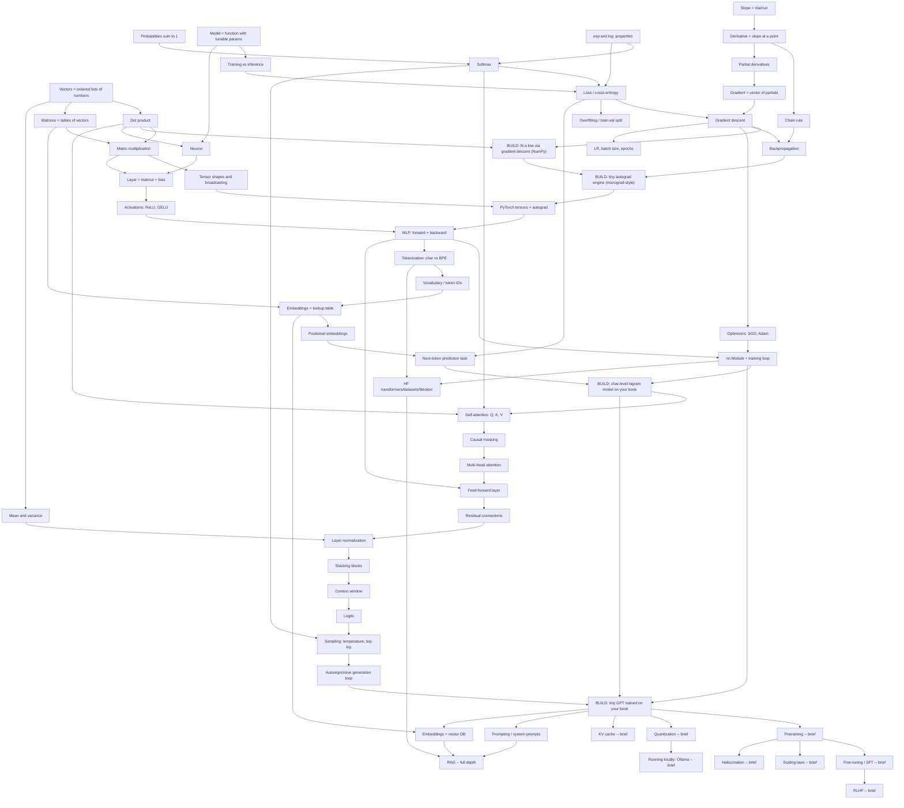

# LLM & Applied AI Engineer roadmap

Goal: an **Applied AI / LLM Engineer** role in about 4 months. Two tracks, learned side by side:

- **Part A, LLM internals:** the LearnHarness map, copied as-is from the LLMs session (as of 2026-11-17, after adding the extra math nodes, the BUILD checkpoints, and marking post-build topics as brief). If LearnHarness changes it, the latest version is in the newest export in `notes/`; update Part A from it.
- **Part B, applied AI engineer:** building production features on top of existing models. Self-study and projects; **not in LearnHarness**, so Part B is maintained here by hand.

Items marked **(light)** only need working knowledge, not depth. Which concepts get a problem, a BUILD or a project step, and what's done: [PROGRESS.md](PROGRESS.md).

## 4-month plan
Target: about **135 hours over ~17 weeks, ~8 hours a week (~70 minutes a day)**. Every concept in Part A and Part B stays; the internals are taught at lower depth instead of being cut.

**Part A, LLM internals: ~50 hours (down from ~100)**
* **Math (~7h):** every node kept, intuition plus one worked example each (~25 min); no calculus drills.
* **Training (~10h):** concepts kept; backprop taught conceptually. BUILDs shortened: NumPy line fit (~2h), mini micrograd for a single neuron (~3h instead of a full engine).
* **Neural nets & PyTorch (~5h):** every node kept, short lessons.
* **Text (~6h):** every node kept; bigram BUILD kept but small (~2h).
* **Transformer & generation (~10h):** full depth (this is what interviews ask about).
* **Tiny GPT BUILD (~10h):** code-along (e.g., Karpathy's "Let's build GPT") rather than from scratch.
* **After-build "brief" topics (~3h):** ~20 min each. Prompting, vector DB and RAG are learned in Part B, not twice.

**Part B, applied AI engineer: ~85 hours**, learned mostly through 2 portfolio projects (a RAG app with evals; an agent with MCP tools). "(light)" items stay light; pillar 6 is mostly reading.

| Weeks | Internals | Applied |
|---|---|---|
| 1–4 | Math + training, line fit + mini micrograd (~20h) | Pillar 1: LLM APIs (~12h) |
| 5–8 | Neural nets, PyTorch, text, bigram, transformer (~20h) | Pillar 4: evals & observability (~12h) |
| 9–12 | Generation + tiny GPT code-along (~12h) | Pillar 2: RAG + project 1 (~20h) |
| 13–17 | After-build brief topics (~3h) | Pillars 3, 5, 7 + project 2 (~25h), pillar 6 reading (~5h) |

If a phase runs over, extend by a week or two rather than cutting a concept.

---

# Part A: LLM internals (LearnHarness map)

## What each node teaches

### Roots
| Node | What it teaches |
|---|---|
| Slope = rise/run | How fast output changes per unit of input |
| Vectors = ordered lists of numbers | Representing a thing (later, a token) as an array of numbers |
| Probabilities sum to 1 | What a probability distribution is |
| Model = function with tunable params | A model is a function whose numbers (parameters) get adjusted |
| exp and log: properties | Exponentials and logarithms; softmax uses exp, cross-entropy uses log |

### Math
| Node | What it teaches |
|---|---|
| Derivative = slope at a point | Slope of a curve at one spot: "nudge the input, how does output move?" |
| Chain rule | Derivative of a function inside a function; backprop is built on it |
| Partial derivatives | Slope for one parameter while holding the others fixed |
| Gradient = vector of partials | All the partial derivatives together: which way to adjust every parameter |
| Dot product | Multiply element-wise and sum; a measure of similarity |
| Matrices = tables of vectors | Many vectors stored together |
| Mean and variance | Average and spread of numbers; layer normalization uses them |
| Matrix multiplication | Many dot products at once; the core operation of every layer |
| Tensor shapes and broadcasting | How (batch, sequence, dimension) arrays combine; where most PyTorch bugs come from |
| Softmax | Turns any list of scores into probabilities |

### Training
| Node | What it teaches |
|---|---|
| Training vs inference | Learning the parameters vs using them |
| Loss / cross-entropy | One number for "how wrong was the prediction" |
| Gradient descent | Step every parameter a little against its gradient, repeat |
| **BUILD: fit a line via gradient descent (NumPy)** | Gradient descent end to end in a few lines of NumPy |
| Backpropagation | Computing all the gradients efficiently, layer by layer |
| **BUILD: tiny autograd engine (micrograd-style)** | Writing the thing that computes gradients automatically |
| Optimizers: SGD, Adam | Smarter ways to take those steps |
| Overfitting / train-val split | Memorizing vs generalizing, and how to detect it |
| LR, batch size, epochs | The main dials of a training run |

### Neural networks and PyTorch
| Node | What it teaches |
|---|---|
| PyTorch tensors + autograd | Arrays on the GPU that compute their own gradients (your micrograd, industrial strength) |
| Neuron | Dot product of inputs and weights, plus bias |
| Layer = matmul + bias | A whole layer of neurons as one matrix multiplication |
| Activations: ReLU, GELU | The nonlinearity that lets networks learn more than straight lines |
| MLP: forward + backward | Stacked layers: data flows forward, gradients flow back |
| nn.Module + training loop | Structuring a model and the code that trains it |

### Text
| Node | What it teaches |
|---|---|
| Tokenization: char vs BPE | Splitting text into characters or sub-word pieces |
| Vocabulary / token IDs | Each token gets an integer ID |
| Embeddings = lookup table | Token ID → vector, like an index lookup |
| Positional embeddings | Telling the model where each token sits |
| Next-token prediction task | The single task a GPT is trained on |
| **BUILD: char-level bigram model on your book** | The simplest language model: guess the next character from the current one |

### Transformer
| Node | What it teaches |
|---|---|
| Self-attention: Q, K, V | Each token does a soft, weighted lookup over the other tokens |
| Causal masking | A token can't see tokens after it |
| Multi-head attention | Several attention lookups in parallel |
| Feed-forward layer | A per-token MLP after attention |
| Residual connections | Adding the input back so deep stacks still train |
| Layer normalization | Keeping numbers in a stable range between layers |
| Stacking blocks | Repeating the transformer block N times |
| Context window | How many tokens the model sees at once |

### Generation
| Node | What it teaches |
|---|---|
| Logits | The raw scores the model outputs for every possible next token |
| Sampling: temperature, top-k/p | Choosing the next token, and controlling randomness |
| Autoregressive generation loop | Generate a token, append it, repeat |

### Goal
| Node | What it teaches |
|---|---|
| **BUILD: tiny GPT trained on your book** | Putting it all together: a small transformer trained on a book, generating text in its style |

### After the build
| Node | What it teaches |
|---|---|
| Pretraining (brief) | Training on huge amounts of text |
| Fine-tuning / SFT (brief) | Further training on examples of the behaviour you want |
| RLHF (brief) | Tuning with human preference feedback |
| Scaling laws (brief) | Why bigger models with more data keep getting better |
| Hallucination (brief) | Why models confidently make things up |
| Quantization (brief) | Shrinking a model by storing its numbers with fewer bits |
| Running locally: Ollama (brief) | Running real models on your own machine |
| KV cache (brief) | Reusing past attention work so generation is fast |
| HF transformers/datasets/tiktoken | Ready-made tokenizers, datasets and pretrained models |
| Prompting / system prompts | Steering a model with instructions |
| Embeddings + vector DB | Storing text as vectors and searching by meaning |
| RAG (full depth) | Retrieving relevant text and giving it to the model to answer from; how you actually ask questions about the book |

---

# Part B: Applied AI engineer (self-study, not in LearnHarness)

### Pillar 1. Context Engineering & Resilient LLM APIs
* **Structured Outputs & Schema Enforcement:** Getting schema-valid JSON/typed responses using Pydantic, tool schemas, and constrained decoding. Schema-valid is not the same as correct or deterministic: still validate the values. Constrained decoding: know what it is **(light)**.
* **Context & Memory Architecture:** Designing system prompts, few-shot patterns, dynamic context assembly, sliding-window vs. summary memory, and **prompt caching** (to reduce latency and token costs).
* **Model Selection & Capabilities:** Reasoning/thinking models vs. fast models, context-window limits, cost/latency/quality tradeoffs, model deprecations and migrations (prompts often break when the model changes; re-run evals on every switch).
* **Multimodal Inputs:** Sending PDFs, images, and screenshots directly to the model; speech-to-text for voice input.
* **Production API Patterns:** Streaming responses (SSE), exponential backoff retries, timeouts, rate-limit handling, and multi-model routing (routing simple tasks to fast/cheap models and complex tasks to reasoning models). Semantic caching (Redis) **(light)**: it can return wrong answers for similar-looking but different questions; prefer prompt caching.
* **Provider Fallback & Gateways:** LiteLLM or an LLM gateway in front of several providers, so an outage or a model change doesn't take the feature down.
* **Async & Batch LLM Workloads:** Queues, batch APIs (about 50% cheaper), long-running jobs, and durable execution (Celery/Temporal) for LLM work that doesn't need an instant answer.

### Pillar 2. Production-Grade RAG (Retrieval-Augmented Generation)
* **Long Context vs. RAG:** Deciding when to put the whole document in the prompt (with prompt caching) instead of building retrieval. Many apps no longer need RAG.
* **Document Ingestion & Chunking:** Parsing messy PDFs, tables, and code; recursive, semantic, and layout-aware chunking; rich metadata extraction.
* **Vector Databases & Indexing:** Choosing storage (`pgvector` in PostgreSQL, Qdrant, Pinecone, Weaviate) and when `pgvector` is enough. HNSW/IVF: know the tradeoffs (speed vs. recall vs. memory), not the internals **(light)**.
* **Query-Side Retrieval:** Query rewriting, multi-query, and HyDE; agentic RAG, where the model decides when and what to search.
* **Hybrid Search & Reranking:** Combining dense vector search with sparse keyword search (BM25), followed by a cross-encoder **reranker** (e.g., Cohere Rerank, BGE) to maximize retrieval precision.
* **Grounded Citations & Refusal:** Enforcing source-chunk citations and instructing models to abstain when retrieved context lacks the answer.

### Pillar 3. AI Agents, Tool Calling & MCP
* **Function / Tool Calling:** Writing unambiguous tool descriptions and strict parameter schemas for database queries and external APIs.
* **Model Context Protocol (MCP):** Building and consuming standardized MCP servers to expose tools, databases, and internal resources cleanly.
* **Stateful Agent Orchestration:** Building controlled agent loops (a custom state machine first; LangGraph is optional) with durable checkpoints, step/cost limits, and **human-in-the-loop** approval gates for high-stakes actions.
* **Agent Context Management:** Compacting or summarizing long agent histories, sub-agents with their own context, and agent SDKs (Claude Agent SDK, OpenAI Agents SDK).

### Pillar 4. Evaluation (Evals) & Observability *(Highest Hiring Priority)*
* **Error Analysis:** Reading real traces, sorting failures into categories, and writing evals for the failures that actually happen. This comes before choosing eval tools.
* **Automated Eval Harnesses:** Creating golden Q&A datasets and running deterministic assertions + LLM-as-a-judge metrics (`Ragas`, `DeepEval`, `pytest`) in CI/CD pipelines to prevent regressions.
* **Synthetic Eval Data:** Using an LLM to generate test questions and edge cases when there are no real users yet.
* **RAG-Specific Metrics:** Measuring retrieval quality (Context Precision, Context Recall) separately from generation quality (Faithfulness, Answer Relevance).
* **Online Evals & Feedback Loops:** Thumbs up/down, user corrections, and A/B tests of prompts and models in production; feeding failures back into the golden dataset.
* **Tracing & Telemetry:** End-to-end request tracing, prompt versioning, latency breakdowns, and per-user/per-tenant token and dollar cost tracking using **Langfuse** or **OpenTelemetry**.

### Pillar 5. Guardrails, Security & Governance
* **Prompt Injection & Jailbreak Defense:** Isolating untrusted user inputs and retrieved document text from system instructions.
* **OWASP Top 10 for LLM Applications:** Insecure output handling (model output rendered as HTML is XSS), excessive agency, data exfiltration through tool calls, and secrets in prompts.
* **Access Control & PII Protection:** Enforcing user/tenant RBAC permissions *inside* vector database metadata filters (preventing cross-tenant data leaks) and redacting PII before sending data to external LLM APIs.
* **Compliance Basics (light):** GDPR, data retention, zero-data-retention agreements with providers, and the EU AI Act for European users.

### Pillar 6. Practical Post-Training & Local/Open-Model Serving *(Secondary / Edge)*
* **Decision Framework:** Knowing when Prompting + RAG solves the problem vs. when Fine-Tuning is actually justified.
* **Parameter-Efficient Fine-Tuning:** LoRA / QLoRA basics for narrow classification, extraction, or strict formatting tasks.
* **Open-Weight Serving:** Running models locally via Ollama and understanding production inference engines (vLLM, quantization tradeoffs).

### Pillar 7. AI Product UX
* **Showing AI Output Well:** Displaying citations and uncertainty, loading and streaming states, streaming partial structured output, and letting users cancel or retry.
* **Designing for Failure:** Fallback answers, "I don't know" states, and making it easy for users to correct the AI (which also feeds the feedback loop in pillar 4).

## Next prompts to ask
1. *"Design 2 end-to-end portfolio projects using Python, FastAPI, PostgreSQL/pgvector, and Redis that cover RAG, hybrid search, MCP tools, and automated evals."*
2. *"Give me a deep-dive checklist on building a CI/CD evaluation suite for a RAG application, starting from error analysis."*
